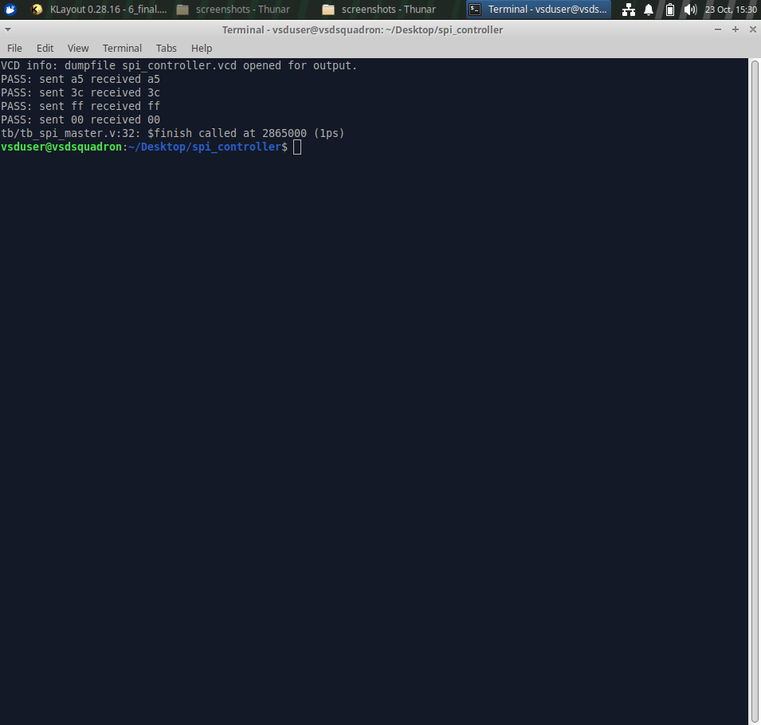
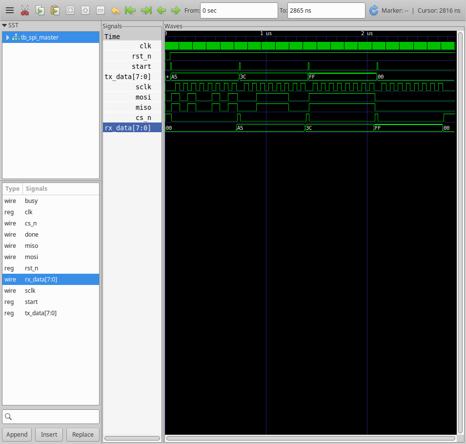
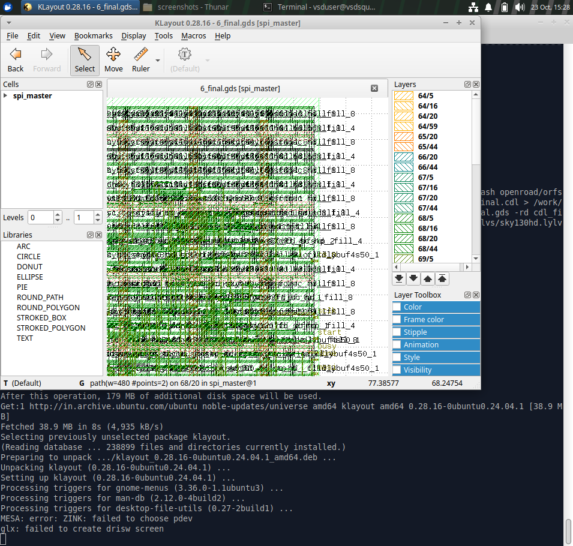
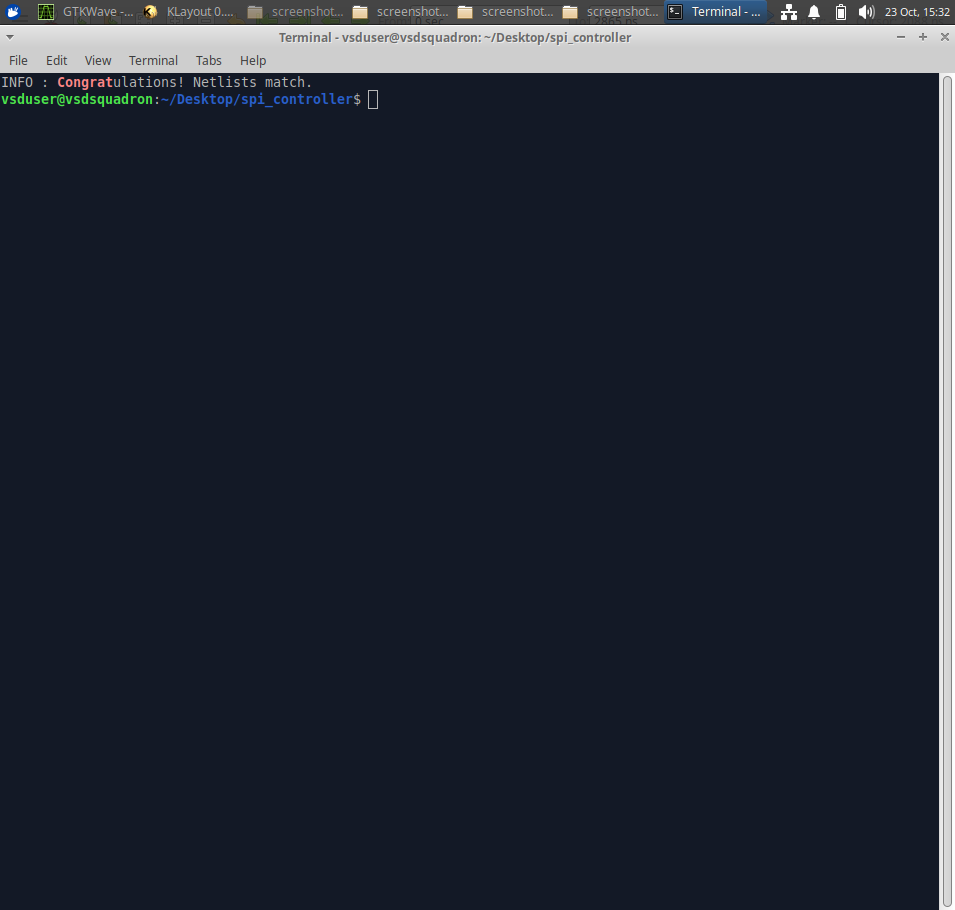
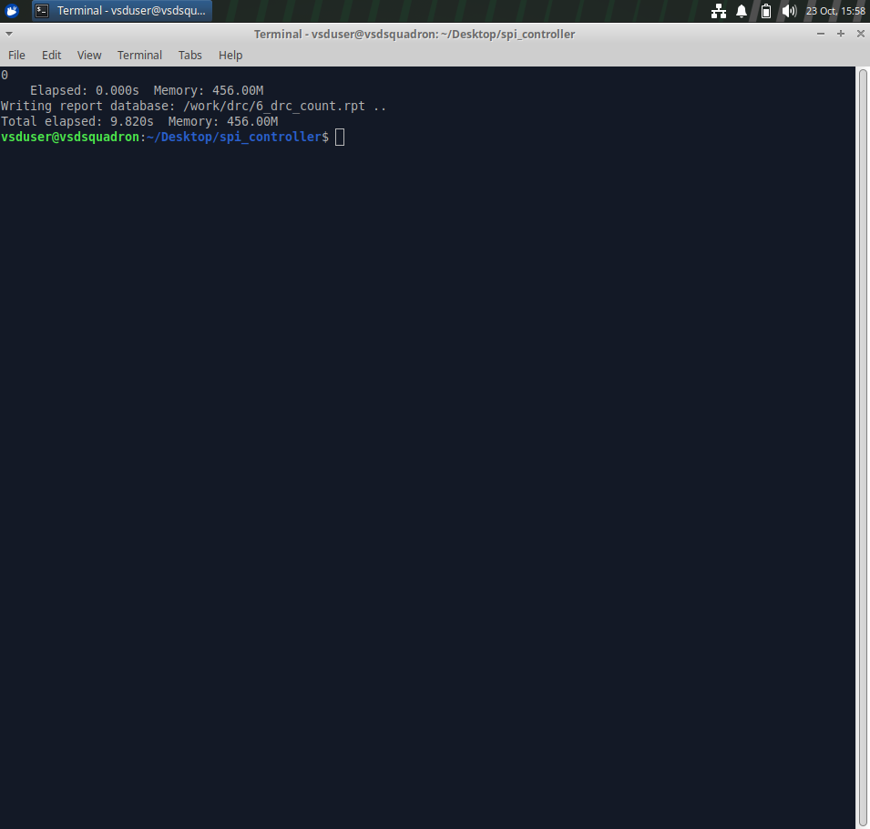

# SPI Master Controller: RTL to GDSII

An 8-bit SPI master (mode 0) taken through the complete open-source RTL-to-GDSII flow on the SkyWater SKY130 (sky130_fd_sc_hd) process using OpenROAD-flow-scripts.

## Design

- Module: `spi_master` (`rtl/spi_master.v`)
- Data width: 8 bits (parameter `DATA_W`), SPI mode 0 (CPOL=0, CPHA=0), MSB first
- Clock divider: `CLK_DIV` (SCLK = clk / (2 x CLK_DIV))
- Ports: `clk`, `rst_n`, `start`, `tx_data`, `miso`, `rx_data`, `busy`, `done`, `sclk`, `mosi`, `cs_n`
- FSM: IDLE, TRANSFER, FINISH

## Project structure

| Folder | Contents |
|---|---|
| `rtl/` | SPI master RTL |
| `tb/` | Self-checking testbench (loopback MISO = MOSI) |
| `flow/` | OpenROAD flow config (`config.mk`) and SDC constraints |
| `reports/` | Synthesis, floorplan, placement, CTS, routing, finish and signoff STA reports |
| `lvs/` | CDL netlist, LVS log and LVS database |
| `screenshots/` | Simulation, waveform, layout and LVS screenshots |

## Flow stages

| Stage | Tool | Status |
|---|---|---|
| RTL design and functional verification | Icarus Verilog, GTKWave | Done, 4/4 tests PASS |
| Logic synthesis | Yosys | Done |
| Floorplan and power planning | OpenROAD | Done |
| Placement | OpenROAD | Done |
| Clock tree synthesis | OpenROAD (TritonCTS) | Done |
| Routing | OpenROAD (TritonRoute) | Done |
| Signoff STA | OpenSTA | Done |
| Physical verification (DRC) | KLayout | Done, 0 violations |
| Layout vs. schematic (LVS) | KLayout | Done, netlists match |
| GDSII generation | OpenROAD, KLayout | Done (`6_final.gds`) |
| DFT (scan insertion) | n/a | Not performed |

## Results

| Metric | Value |
|---|---|
| Technology | SKY130 HD |
| Clock period | 10 ns (100 MHz) |
| Synthesized chip area | 1819.24 um2 |
| Sequential area share | 49.66 % |
| Setup worst slack | +6.44 ns (met) |
| Hold worst slack | +0.51 ns (met) |
| TNS | 0.00 |
| Routing DRC violations | 0 |
| KLayout DRC (sky130hd.lydrc) | 0 violations |
| LVS | Netlists match |

## Screenshots

### Simulation

### Waveform

### Final layout

### LVS result

## How to reproduce

Simulation:

    iverilog -o spi_sim rtl/spi_master.v tb/tb_spi_master.v
    vvp spi_sim

Physical design (Docker image `openroad/orfs:latest`):

    docker run --rm -v $PWD:/work openroad/orfs:latest bash -c \
      "cd /OpenROAD-flow-scripts/flow && make DESIGN_CONFIG=/work/flow/config.mk WORK_HOME=/work/flow/work"

### DRC result

## Project Video

https://drive.google.com/file/d/1-69ZHbw95GqfKljr5u7_27WzlsTPVxzO/view?usp=drivesdk
